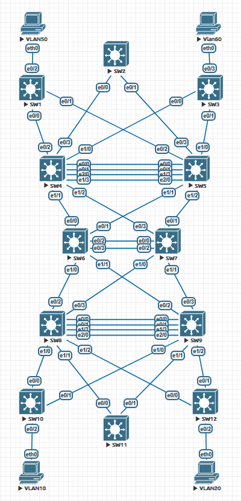

# لب شبکه‌ی کمپوس (EVE-NG): دو ساختمان، HSRP و OSPF

[English](README.md)

یک شبکه‌ی کمپوس دو ساختمانه که توی EVE-NG ساخته و تست شده. هر ساختمان یک جفت سوییچ distribution با HSRP داره، دو ساختمان با یک core روتینگ‌شده به هم وصل می‌شن و همه‌ی سوییچ‌های پایین‌تر با VLAN از هم جدا شدن.

توی این ریپو کانفیگ نهایی (running-config) همه‌ی دستگاه‌ها، جدول آدرس‌دهی، و یک گزارش از مشکل‌هایی که موقع ساخت پیش اومد هست (از جمله یکی که علتش کاملاً مشخص نشد).



## این لب چی نشون می‌ده

- - &rlm;**access لایه ۲:** VLAN، RSTP (`rapid-pvst`)، ترانک dot1q با native VLAN 66، DHCP snooping، port security، PortFast همراه BPDU guard، و پورت‌های بلااستفاده که توی VLAN 666 قرار دارن و shutdown هستن.
- - &rlm;**redundancy توی distribution:** دو سوییچ لایه ۳ برای هر ساختمان، HSRP به‌ازای هر VLAN (شماره‌ی گروه برابر شماره‌ی VLAN)، STP root هماهنگ با سوییچ Active در HSRP، و `preempt` فعال.
- - &rlm;**core و لینک‌های routed:** OSPF process 1 و area 0، با لینک‌های point-to-point (۱۸ لینک routed، همه `/24`).
- **تست failover:** خرابی distribution توی هر دو ساختمان و خرابی یک نود core (نتیجه‌ها پایین‌تر).

## ساختار کلی

| لایه | دستگاه‌ها | توضیح |
|---|---|---|
| Core | SW6-CORE-1، SW7-CORE-2 | فقط routed، OSPF |
| Distribution ساختمان ۱ | SW8-DIS-B1، SW9-DIS-B1 | VLAN 10 تا 40، HSRP |
| Distribution ساختمان ۲ | SW4-DIS-B2، SW5-DIS-B2 | VLAN 50 تا 80، HSRP |
| Access ساختمان ۱ | SW10، SW11، SW12 (با پسوند -ACC-B1) | فقط لایه ۲ |
| Access ساختمان ۲ | SW1، SW2، SW3 (با پسوند -ACC-B2) | فقط لایه ۲ |
| هاست‌ها | ۴ تا VPCS | یکی برای هر VLANِ تست‌شده (10، 20، 50، 60) |

جدول‌های کامل (VLANها، IP مجازی HSRP، هر ۱۸ لینک، پورت‌های access و هاست‌ها) توی [docs/addressing.md](docs/addressing.md) هست (انگلیسی).

## پیش‌نیازها

- EVE-NG: Community Edition 6.0.1-9
- ایمیج نودها: Cisco IOL L2 / L3 images (کانفیگ‌ها با syntax نسخه‌ی IOS 15.1 نوشته شدن. نودهای access و distribution باید switchport لایه ۲ داشته باشن و نودهای distribution و core باید روتینگ لایه ۳ داشته باشن.)
- RAM و CPU کافی برای ۱۲ نود سوییچ به‌علاوه‌ی VPCS. اگه منابع host کم باشه، نودها دیر بالا میان.

## راه‌اندازی سریع

1. نودها رو بساز و مثل عکس توپولوژی کابل‌کشی کن. اسم هر نود توی EVE رو همون hostname بذار (موقع ساخت لب، اسم نودها با hostname یکی نبود و باعث سردرگمی شد).
2. هر فایل داخل `configs/` رو توی نودی که hostname یکسان داره paste کن. کانفیگ رو تکه‌تکه (۱۰ تا ۲۰ خط) paste کن و با `show running-config` چک کن. موقع ساخت لب، paste طولانی توی کنسول EVE بعضی خطوط رو جا می‌انداخت.
3. روی سوییچ‌های لایه ۳ (distribution و core) مطمئن شو `ip routing` فعاله و VLANها روی هر سوییچی که لازم داره ساخته شدن (`vlan 10,20,30,40,66,666` توی ساختمان ۱ و `vlan 50,60,66,70,80,666` توی ساختمان ۲). فایل‌های access خط `vlan` خودشون رو دارن، ولی فایل‌های distribution ندارن، چون روی ایمیج‌های استفاده‌شده نه `ip routing` و نه VLAN database توی `show running-config` نشون داده نمی‌شد.
4. روی هر نود `wr` بزن تا ذخیره بشه.
5. همه‌ی نودها رو روشن کن و چند دقیقه صبر کن تا OSPF و HSRP جا بیفتن.
6. آدرس VPCSها رو ست کن (جدول هاست‌ها توی addressing.md) و `save` بزن. مثال: `ip 192.168.10.100/24 192.168.10.11`

## بررسی درستی کار

| چک | دستور | نتیجه‌ی مورد انتظار |
|---|---|---|
| همسایه‌های OSPF | `show ip ospf neighbor` | همه `FULL` (۴ لینک routed به سوییچ مقابل، به‌علاوه‌ی همسایگی روی SVIها) |
| نقش HSRP | `show standby brief` | ساختمان ۱: SW8 برای VLAN 10 و 20 و SW9 برای 30 و 40 Active. ساختمان ۲: SW5 برای 50 و 60 و SW4 برای 70 و 80 Active. بدون `unknown` یا `Init` |
| ترانک‌ها | `show interfaces trunk` | Mode برابر `on` و native VLAN برابر 66 |
| STP | `show spanning-tree vlan <n>` | root همون سوییچ Active در HSRP برای اون VLAN |
| هاست به گیتوی | `ping <IP مجازی>` | جواب می‌گیره |
| هاست به هاست (بین VLANها و ساختمان‌ها) | `ping <VPC دیگه>` | جواب می‌گیره و TTL به‌ازای هر hop روتینگ یکی کم می‌شه |
| بار پورت‌ها (چک طوفان) | ‎`show interfaces \| include ^Ethernet\|input rate`‎ | پورت‌های بی‌کار نزدیک صفر packet در ثانیه |

## نتیجه‌ی تست‌های failover

| تست | کار انجام‌شده | نتیجه |
|---|---|---|
| distribution ساختمان ۱ | SW8 (Active برای VLAN 10 و 20) متوقف شد | SW9 برای همه‌ی VLANها Active شد. ارتباط بعد از `clear arp` روی VPC برگشت. وقتی SW8 برگشت، `preempt` دوباره اون رو Active کرد. |
| distribution ساختمان ۲ | SW5 (Active برای VLAN 50 و 60) متوقف شد | SW4 برای همه‌ی VLANها Active شد. رفتار ARP روی VPC مثل ساختمان ۱ بود. SW5 بعد از ری‌استارت نقشش رو پس گرفت. |
| یک نود core | SW6 متوقف شد | ترافیک بین دو ساختمان بعد از حدود ۳۸ ثانیه خودش از مسیر SW7 برگشت. این با dead timer پیش‌فرض OSPF (۴۰ ثانیه) جور درمیاد. فقط یک بار اندازه‌گیری شده. |

رفتار ARP به‌خاطر `standby use-bia` هست (پایین‌تر توضیح داده شده).

## محدودیت‌ها و موارد شناخته‌شده

- **`standby use-bia` یک راه‌حل موقته، نه طراحی پیشنهادی.** بدون اون، ترافیک بین VLANها روی ایمیج‌های شبیه‌سازی یک طوفان لایه ۲ می‌ساخت (جزئیات توی [docs/troubleshooting.md](docs/troubleshooting.md)، انگلیسی). با اون، MAC گیتوی همون MAC واقعی سوییچ Active می‌شه، پس موقع failover عوض می‌شه و هاست‌ها ARP قدیمی رو تا وقتی پاک نشه نگه می‌دارن. روی سخت‌افزار واقعی و با MAC مجازی استاندارد HSRP انتظار نمی‌رود این اتفاق بیفته، ولی اینجا تست نشده.
- **DHCP server وجود نداره.** DHCP snooping فعاله، ولی چیزی آدرس نمی‌ده و آدرس VPCSها دستیه.
- **port security سخت‌گیرانه نیست.** روی همه‌ی پورت‌های access مقدار `maximum 200` ست شده.
- **`ip routing` و VLAN database** روی ایمیج‌های استفاده‌شده توی `show running-config` نمایش داده نمی‌شن، با اینکه فعال هستن.
- **DAI پیکربندی نشده.** دستور `ip arp inspection` روی ایمیج سوییچ‌های access قبول نشد.

## ساختار ریپو

```
.
├── README.md
├── README.fa.md
├── configs/
│   ├── access/         SW1، SW2، SW3 (ساختمان ۲)؛ SW10، SW11، SW12 (ساختمان ۱)
│   ├── distribution/   SW4، SW5 (ساختمان ۲)؛ SW8، SW9 (ساختمان ۱)
│   └── core/           SW6، SW7
├── docs/
│   ├── addressing.md   VLANها، HSRP، لینک‌های routed، پورت‌های access، هاست‌ها
│   └── troubleshooting.md
└── topology/
    └── topology.png    اسکرین‌شات توپولوژی EVE
```
