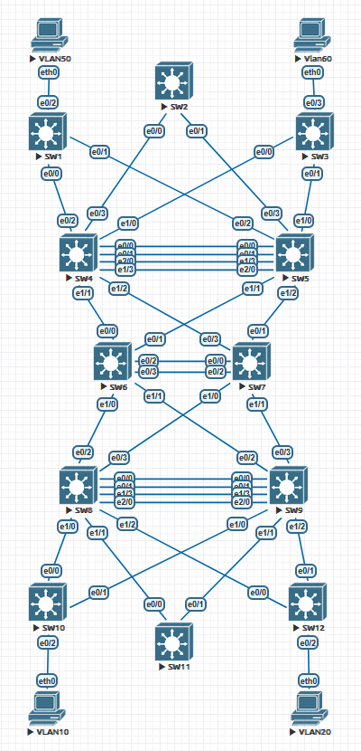

# Campus network lab (EVE-NG): two buildings, HSRP, OSPF

A two-building campus network built and tested in EVE-NG. Each building has a redundant pair of distribution switches running HSRP, the buildings are joined by a routed core, and everything below the core is segmented with VLANs.

The repo contains the final running-config of every device, the addressing plan, and a write-up of the problems hit while building it (including one that is not fully explained).



## What it demonstrates

- **Layer 2 access:** VLANs, RSTP (`rapid-pvst`), dot1q trunks with native VLAN 66, DHCP snooping, port security, PortFast with BPDU guard, unused ports parked in VLAN 666 and shut down.
- **Distribution redundancy:** two Layer 3 switches per building, HSRP per VLAN (group number = VLAN number), STP root aligned with the HSRP active switch, `preempt` enabled.
- **Routed core and interconnects:** OSPF process 1, area 0, point-to-point links everywhere (18 routed links, all `/24`).
- **Failover testing:** distribution failure in both buildings and a core node failure (results below).

## Design at a glance

| Layer | Devices | Notes |
|---|---|---|
| Core | SW6-CORE-1, SW7-CORE-2 | Routed only, OSPF |
| Distribution, building 1 | SW8-DIS-B1, SW9-DIS-B1 | VLANs 10-40, HSRP |
| Distribution, building 2 | SW4-DIS-B2, SW5-DIS-B2 | VLANs 50-80, HSRP |
| Access, building 1 | SW10, SW11, SW12 (-ACC-B1) | Layer 2 only |
| Access, building 2 | SW1, SW2, SW3 (-ACC-B2) | Layer 2 only |
| Hosts | 4 x VPCS | One per tested VLAN (10, 20, 50, 60) |

Full tables (VLANs, HSRP virtual IPs, all 18 links, access ports, hosts) are in [docs/addressing.md](docs/addressing.md).

## Requirements

-  EVE-NG: Community Edition 6.0.1-9
- Node images: Cisco IOL L2 / L3 images (the configs use IOS 15.1 syntax; the access and distribution nodes need Layer 2 switchport support, the distribution and core nodes need Layer 3 routing)
- Enough RAM/CPU for 12 switch nodes plus VPCS. Nodes boot slowly when the host is short on resources. (the configs use IOS 15.1 syntax; the access and distribution nodes need Layer 2 switchport support, the distribution and core nodes need Layer 3 routing)
- Enough RAM/CPU for 12 switch nodes plus VPCS. Nodes boot slowly when the host is short on resources.

## Quick start

1. Create the nodes and cable them to match the topology image. Rename each node in EVE to its hostname (EVE labels and hostnames did not match during development, which caused confusion).
2. Paste each file from `configs/` into the node with the same hostname. Paste in small chunks (10-20 lines) and check the result with `show running-config`; long pastes into the EVE console dropped lines during development.
3. On the Layer 3 switches (distribution and core), make sure `ip routing` is enabled and that VLANs exist on every switch that needs them (`vlan 10,20,30,40,66,666` in building 1, `vlan 50,60,66,70,80,666` in building 2). The access-switch files already contain their `vlan` line; the distribution files do not, because on the images used neither `ip routing` nor the VLAN database was shown in `show running-config`.
4. Save every node with `wr`.
5. Start all nodes and wait a few minutes for OSPF and HSRP to settle.
6. Set the addresses on the VPCS (see the hosts table in the addressing plan), then `save`. Example: `ip 192.168.10.100/24 192.168.10.11`.

## Verification

| Check | Command | Expected |
|---|---|---|
| OSPF adjacencies | `show ip ospf neighbor` | All neighbors `FULL` (4 routed links to the peer plus the SVI adjacencies on each distribution switch) |
| HSRP roles | `show standby brief` | Building 1: SW8 Active for VLAN 10/20, SW9 for 30/40. Building 2: SW5 Active for 50/60, SW4 for 70/80. No `unknown` or `Init` |
| Trunks | `show interfaces trunk` | Mode `on`, native VLAN 66 |
| STP | `show spanning-tree vlan <n>` | Root is the HSRP active switch of that VLAN |
| Host to gateway | `ping <virtual IP>` | Replies |
| Host to host, across VLANs and buildings | `ping <other VPC>` | Replies, TTL decreases by one per routed hop |
| Port load (storm check) | `show interfaces \| include ^Ethernet\|input rate` | Idle ports near zero packets/s |

## Failover test results

| Test | What was done | Observed |
|---|---|---|
| Building 1 distribution | Stopped SW8 (HSRP active for VLAN 10/20) | SW9 became Active for all VLANs. Traffic recovered after `clear arp` on the VPC. When SW8 came back, `preempt` made it Active again. |
| Building 2 distribution | Stopped SW5 (HSRP active for VLAN 50/60) | SW4 became Active for all VLANs. Same ARP behaviour on the VPC. SW5 took the role back after restart. |
| Core node | Stopped SW6 | Inter-building traffic recovered by itself through SW7 after about 38 seconds, which matches the default OSPF dead timer (40 s). Measured once. |

The ARP behaviour comes from `standby use-bia` (see below).

## Known limitations

- **`standby use-bia` is a workaround, not a recommended design.** Without it, inter-VLAN traffic caused a Layer 2 storm on the emulated images (details in [docs/troubleshooting.md](docs/troubleshooting.md)). With it, the gateway MAC is the real MAC of the active switch, so it changes on failover and hosts keep the old ARP entry until it is cleared. On real hardware with the standard HSRP virtual MAC this is not expected to happen, but that was not tested here.
- **No DHCP server.** DHCP snooping is enabled, but nothing hands out addresses; VPCS addresses are static.
- **Port security is permissive.** `maximum 200` on all access ports.
- **`ip routing` and the VLAN database** do not appear in `show running-config` on the images used, even though they are active.
- **DAI is not configured.** `ip arp inspection` was rejected by the access-switch image.

## Repository layout

```
.
├── README.md
├── configs/
│   ├── access/         SW1, SW2, SW3 (building 2); SW10, SW11, SW12 (building 1)
│   ├── distribution/   SW4, SW5 (building 2); SW8, SW9 (building 1)
│   └── core/           SW6, SW7
├── docs/
│   ├── addressing.md   VLANs, HSRP, all routed links, access ports, hosts
│   └── troubleshooting.md
└── topology/
    └── topology.png    screenshot of the EVE topology
```
