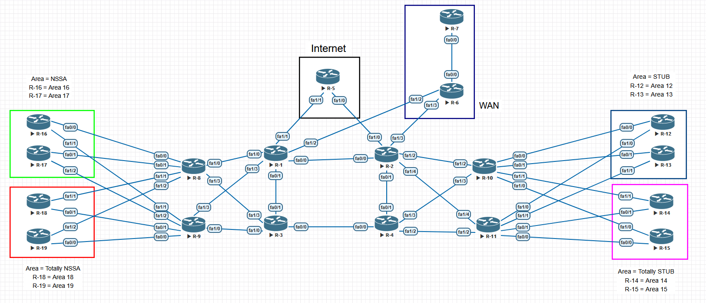

# لب OSPF areas (EVE-NG): stub، totally stub، NSSA و totally NSSA

[English](README.md)

> این لب از موضوع‌های یک workshop دوره‌ی CCNP ENCOR/ENARSI الهام گرفته است. توپولوژی، آدرس‌دهی و کانفیگ‌ها کار خودم است.

یک شبکه‌ی OSPF با ۱۹ روتر، شامل backbone، یک روتر Internet، یک دامنه‌ی WAN جدا و چهار جفت روتر برگ (leaf) که هر جفت توی یک نوع area قرار دارن. توی این ریپو کانفیگ نهایی (running-config) هر روتر، جدول آدرس‌دهی، نتیجه‌ی جدول‌های روتینگ که دیده شد و گزارشی از مشکل‌هایی که موقع ساخت پیش اومد هست.



## این لب چی نشون می‌ده

- **نوع area ها:** stub (12 و 13)، totally stub (14 و 15)، NSSA (16 و 17، و area 10 برای روتر WAN edge) و totally NSSA (18 و 19).
- **رفتار ABR:** خلاصه‌سازی بین area ها با `area range`، و default route توی area های stub و NSSA (`stub no-summary`، `nssa default-information-originate`، `nssa no-summary`).
- **رفتار ASBR:** R-5 یک default route می‌سازه (`default-information originate always`)، R-17 یک ASBR داخل NSSA هست (`redistribute connected`)، و R-8 و R-9 مسیرهای external رو با `summary-address` خلاصه می‌کنن.
- **دو دامنه‌ی OSPF:** R-6 بین OSPF 1 و OSPF 2 (همون WAN) با route-map، prefix-list و tag redistribute می‌کنه.
- **انتخاب DR/BDR** روی یک لینک broadcast (R-1 و R-2 با priority برابر 255 و 254).
- **انتخاب مسیر:** `ip ospf cost` روی روترهای برگ، یکی از دو ABR رو برای هر روتر ترجیح می‌ده.

## ساختار کلی

| بخش | روترها | توضیح |
|---|---|---|
| Backbone (area 0) | R-1 تا R-4 | R-1 و R-2 برای area 5 و 10 هم ABR هستن |
| Internet edge | R-5 (area 5) | default route رو می‌سازه |
| WAN | R-6 (area 10، NSSA) و R-7 | R-7 یک پروسه‌ی جدا (OSPF 2) اجرا می‌کنه |
| Aggregation چپ | R-8 و R-9 | ABR برای area 16 تا 19 |
| Aggregation راست | R-10 و R-11 | ABR برای area 12 تا 15 |
| Stub / totally stub | R-12 و R-13 / R-14 و R-15 | هر area یک روتر |
| NSSA / totally NSSA | R-16 و R-17 / R-18 و R-19 | هر area یک روتر |

سمت برگ، هر روتر area مخصوص خودش رو داره (R-12 توی area 12 و همین‌طور بقیه). جدول‌های کامل (دستگاه‌ها، area ها، سیاست‌های روتینگ، هر ۳۳ لینک و loopbackها) توی [docs/addressing.md](docs/addressing.md) هست (انگلیسی).

## پیش‌نیازها

- &rlm;EVE-NG: Community Edition 6.0.1-9
- ایمیج نودها: روتر Cisco 3725 (Dynamips) با syntax نسخه‌ی IOS 12.4. کانفیگ‌ها از پورت‌های `FastEthernet1/0` تا `1/15` با `no switchport` استفاده می‌کنن، پس روترها توی slot شماره‌ی 1 یک ماژول EtherSwitch ۱۶ پورته لازم دارن.
- &rlm;RAM: ۱۲۸ MB برای هر روتر. با ۲۵۶ MB برای هر روتر، ۱۹ نود حافظه‌ی یک VM هفت گیگابایتی رو تموم کرد (توضیح توی [docs/troubleshooting.md](docs/troubleshooting.md)، انگلیسی).
- منابع استفاده‌شده توی تست: یک VM برای EVE-NG با ۷ GB RAM و ۴ vCPU. وقتی هر ۱۹ روتر روشن بودن، حدود ۳.۹ GB RAM استفاده می‌شد، load average حدود ۲ بود و هر پروسه‌ی `dynamips` حدود ۷٪ CPU می‌خورد.

## راه‌اندازی سریع

1. ۱۹ نود رو بساز و مثل عکس توپولوژی کابل‌کشی کن. اسم هر نود رو همون hostname بذار.
2. هر فایل داخل `configs/` رو توی روتری که hostname یکسان داره paste کن. کانفیگ رو تکه‌تکه paste کن و با `show running-config` چک کن.
3. هر روتر رو با `wr` ذخیره کن.
4. روترها رو روشن کن (اگه host کند بود، اول backbone) و چند دقیقه صبر کن تا همسایگی‌ها بالا بیان.

## نتیجه‌هایی که دیده شد

این‌ها از روی روترها گرفته شده، وقتی لب روشن بود.

| روتر | دستور | نتیجه |
|---|---|---|
| R-9 | `show ip ospf neighbor` | ۶ همسایه که همه `FULL` هستن: R-1، R-3، R-16، R-17، R-18 و R-19 |
| R-1 | ‎`show ip route ospf \| include 172.20`‎ | area 16 فقط به‌صورت یک `O IA 172.20.0.0/22` (از طریق R-9) دیده می‌شه. loopbackهای R-18 و R-19 به‌صورت `O IA /32` و خلاصه‌ی external به‌صورت `O E2 172.20.0.0/20` |
| R-9 | `show ip route ospf` | loopbackهای R-17 به‌صورت `O N2 172.20.4.0/24` تا `172.20.7.0/24`. مسیرهای `172.20.0.0/22` و `172.20.0.0/20` به‌صورت summary به `Null0`. default route به‌صورت `O*E2 0.0.0.0/0` از طریق R-1 |
| R-9 | `show ip route ospf` | از loopbackهای WAN فقط `172.30.0.7` و `172.30.1.7` میان (به‌صورت `O E2`). `172.30.2.7` و `172.30.3.7` با prefix-list روی R-6 بلاک می‌شن |

## رفتار مورد انتظار در هر نوع area

این‌ها از قواعد نوع area ها در OSPF میان، نه از خروجی این لب.

| نوع area | روترها | جدول روتینگ باید داشته باشه |
|---|---|---|
| Stub | R-12 و R-13 | مسیرهای داخل area و بین area ها، به‌علاوه‌ی default route از ABR (`O*IA`) و بدون مسیر external |
| Totally stub | R-14 و R-15 | مسیرهای داخل area و فقط default route (`O*IA`) |
| NSSA | R-16 و R-17 | مسیرهای داخل area و بین area ها، به‌علاوه‌ی default route از نوع Type 7 (`O*N2`) از ABR |
| Totally NSSA | R-18 و R-19 | مسیرهای داخل area و فقط default route (`O*IA`) |

## نکته‌ها

- &rlm;**WAN یک دامنه‌ی OSPF جداست.** R-1 و R-2 توی area 10 (NSSA) default route نمی‌سازن، پس R-6 از OSPF 1 default route نمی‌گیره. این عمدیه.
- &rlm;**loopbackها به‌صورت مسیر `/32` تبلیغ می‌شن** (رفتار پیش‌فرض OSPF برای loopback)، پس `area range` و `summary-address` اون‌ها رو خلاصه می‌کنن.
- **هر دو روتر R-8 و R-9 یک `summary-address` یکسان دارن**، ولی توی هر NSSA فقط یک ABR (اونی که router-id بالاتر داره) Type 7 رو به Type 5 تبدیل می‌کنه. روی R-1 خلاصه‌ی external از R-9 میاد.
- &rlm;**`ip ospf cost` روی یک روتر برگ** فقط مسیر خروجیِ خود همون روتر رو عوض می‌کنه.

## ساختار ریپو

```
02-ospf-areas/
├── README.md
├── README.fa.md
├── configs/
│   ├── backbone/       R-1 تا R-4
│   ├── edge-wan/       R-5، R-6، R-7
│   ├── aggregation/    R-8 تا R-11
│   ├── stub-areas/     R-12 تا R-15
│   └── nssa-areas/     R-16 تا R-19
├── docs/
│   ├── addressing.md
│   └── troubleshooting.md
└── topology/
    └── topology.png
```
