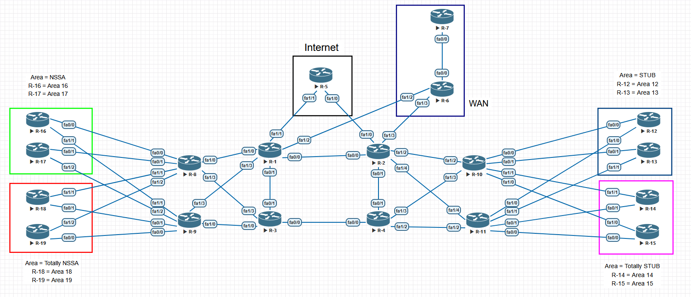

# OSPF areas lab (EVE-NG): stub, totally stub, NSSA and totally NSSA

[Persian version (فارسی)](README.fa.md)

> This lab follows topics from a CCNP ENCOR/ENARSI course workshop. The topology, addressing and configurations are my own.

A 19-router OSPF network with a backbone, an Internet edge, a separate WAN domain, and four pairs of leaf routers, each pair in a different area type. The repo contains the final running-config of every router, the addressing plan, the observed routing-table results, and a write-up of the problems hit while building it.



## What it demonstrates

- **Area types:** stub (12, 13), totally stub (14, 15), NSSA (16, 17, and 10 for the WAN edge), totally NSSA (18, 19).
- **ABR behaviour:** inter-area summarization with `area range`, default routes into stub and NSSA areas (`stub no-summary`, `nssa default-information-originate`, `nssa no-summary`).
- **ASBR behaviour:** R-5 originates a default route (`default-information originate always`); R-17 is an ASBR inside an NSSA (`redistribute connected`); R-8 and R-9 summarize the external routes with `summary-address`.
- **Two OSPF domains:** R-6 redistributes between OSPF 1 and OSPF 2 (the WAN) with route-maps, prefix-lists and tags.
- **DR/BDR election** on one broadcast link (R-1 and R-2, priority 255 and 254).
- **Path preference:** `ip ospf cost` on the leaf routers selects one ABR per leaf.

## Design at a glance

| Part | Routers | Notes |
|---|---|---|
| Backbone (area 0) | R-1 to R-4 | R-1 and R-2 are also ABRs for areas 5 and 10 |
| Internet edge | R-5 (area 5) | Originates the default route |
| WAN | R-6 (area 10, NSSA), R-7 | R-7 runs a separate OSPF process 2 |
| Left aggregation | R-8, R-9 | ABRs for areas 16 to 19 |
| Right aggregation | R-10, R-11 | ABRs for areas 12 to 15 |
| Stub / totally stub | R-12, R-13 / R-14, R-15 | One router per area |
| NSSA / totally NSSA | R-16, R-17 / R-18, R-19 | One router per area |

Every router has its own area number on the leaf side (R-12 is area 12, and so on). The full tables (devices, areas, routing policy, all 33 links, loopbacks) are in [docs/addressing.md](docs/addressing.md).

## Requirements

- EVE-NG: Community Edition 6.0.1-9
- Node images: Cisco 3725 (Dynamips), IOS 12.4 syntax. The configs use `FastEthernet1/0` to `1/15` with `no switchport`, so the routers need a 16-port EtherSwitch module in slot 1.
- RAM: 128 MB per router. With 256 MB per router, 19 nodes exhausted the memory of a 7 GB VM (see [docs/troubleshooting.md](docs/troubleshooting.md)).
- Resources used in testing: an EVE-NG VM with 7 GB RAM and 4 vCPUs. With all 19 routers running, about 3.9 GB of RAM was in use, the load average was about 2, and each `dynamips` process used about 7% CPU.

## Quick start

1. Create the 19 nodes and cable them like the topology image. Name each node after its hostname.
2. Paste each file from `configs/` into the router with the same hostname. Paste in small chunks and check with `show running-config`.
3. Save every router with `wr`.
4. Start the routers (the backbone first if the host is slow) and wait a few minutes for the adjacencies.

## Observed results

Taken from the routers while the lab was running.

| Router | Command | Result |
|---|---|---|
| R-9 | `show ip ospf neighbor` | 6 neighbors, all `FULL`: R-1, R-3, R-16, R-17, R-18, R-19 |
| R-1 | `show ip route ospf \| include 172.20` | Area 16 appears as one `O IA 172.20.0.0/22` (via R-9); loopbacks of R-18 and R-19 as `O IA /32`; the external summary as `O E2 172.20.0.0/20` |
| R-9 | `show ip route ospf` | R-17 loopbacks as `O N2 172.20.4.0/24` to `172.20.7.0/24`; `172.20.0.0/22` and `172.20.0.0/20` as summary routes to `Null0`; default route as `O*E2 0.0.0.0/0` via R-1 |
| R-9 | `show ip route ospf` | Only `172.30.0.7` and `172.30.1.7` of the WAN loopbacks arrive (as `O E2`); `172.30.2.7` and `172.30.3.7` are blocked by the prefix-list on R-6 |

## What to expect in each area type

These follow from the OSPF area types (not captured from this lab).

| Area type | Routers | Routing table should contain |
|---|---|---|
| Stub | R-12, R-13 | Intra- and inter-area routes plus a default route from the ABR (`O*IA`), no external routes |
| Totally stub | R-14, R-15 | Intra-area routes plus only the default route (`O*IA`) |
| NSSA | R-16, R-17 | Intra- and inter-area routes plus a Type 7 default (`O*N2`) from the ABR |
| Totally NSSA | R-18, R-19 | Intra-area routes plus only the default route (`O*IA`) |

## Notes

- **The WAN is a separate OSPF domain.** R-1 and R-2 do not originate a default route into NSSA area 10, so R-6 does not receive one from OSPF 1. This is intended.
- **Loopbacks are advertised as `/32` host routes** (the OSPF default for loopbacks), so the `area range` and `summary-address` commands summarize them.
- **Both R-8 and R-9 have the same `summary-address`**, but only one ABR per NSSA translates Type 7 to Type 5 (the one with the highest router-id). On R-1 the external summary arrives from R-9.
- **`ip ospf cost` on a leaf router** only changes that router's own outbound path.

## Repository layout

```
02-ospf-areas/
├── README.md
├── README.fa.md
├── configs/
│   ├── backbone/       R-1 to R-4
│   ├── edge-wan/       R-5, R-6, R-7
│   ├── aggregation/    R-8 to R-11
│   ├── stub-areas/     R-12 to R-15
│   └── nssa-areas/     R-16 to R-19
├── docs/
│   ├── addressing.md
│   └── troubleshooting.md
└── topology/
    └── topology.png
```
